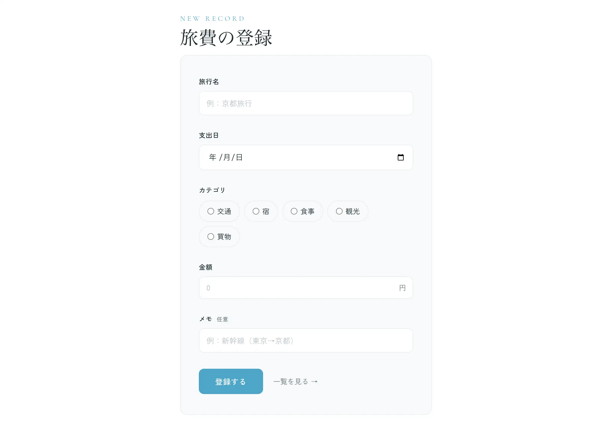
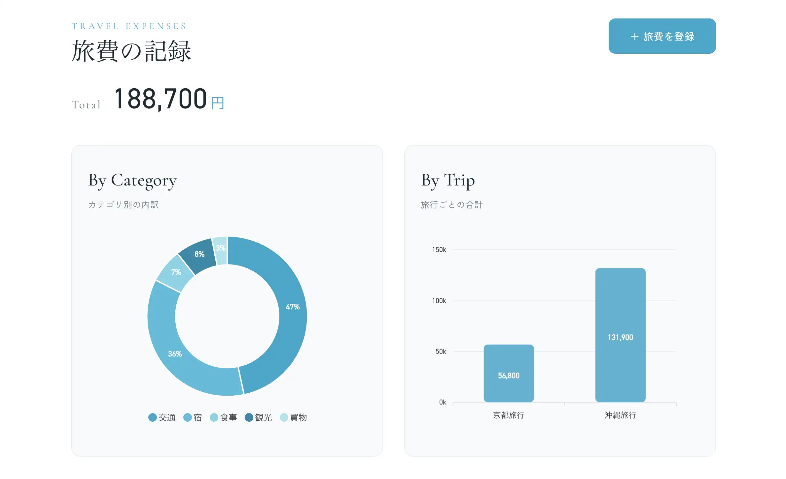

# 旅費の記録




旅行ごとの支出を記録し、合計金額や支出の内訳をグラフで確認できるWebアプリです。旅行名・支出日・カテゴリ・金額を登録するだけで、カテゴリ別・旅行別に自動で集計します。

- **デモ**：https://gs2026-arakawa.sakura.ne.jp/kadai06_basic_php/
- **ログイン**：不要（登録フォームから入力するだけで利用できます）

今後制作したい旅行アプリに搭載する機能の一部として作りました。PHPでのデータの登録・表示の仕組みを、データベースを使わずファイルの読み書きから理解することを目標にしています。

---

## 主な機能

### 支出の登録

- 旅行名・支出日・カテゴリ（交通／宿／食事／観光／買物）・金額・メモを入力して登録
- 旅行名の入力欄に、過去に登録した旅行名を候補として表示

### 支出の一覧・集計

- 登録した支出の一覧と総合計を表示
- カテゴリ別の内訳をドーナツグラフで、旅行ごとの合計を棒グラフで表示

---

## 使用技術

| 分類 | 技術 |
|---|---|
| フロントエンド | HTML / CSS / JavaScript / ApexCharts |
| バックエンド | PHP（フレームワークなし） |
| データ保存 | JSONファイル |
| インフラ | さくらのレンタルサーバー（本番）／ MAMP（ローカル開発） |

### ディレクトリ構成

```
.
├── index.php        # 支出の登録フォーム
├── read.php         # 保存処理・一覧・集計
├── func.php         # 共通関数（XSS対策）
├── script.js        # グラフ描画（ApexCharts）
├── style.css
└── data/
    └── data.json    # 支出データ
```

---

## 工夫した点

### データの保存と集計

- `file_get_contents()` / `file_put_contents()` でJSONファイルを読み書きし、データベースを使わずに登録（Create）と表示（Read）を実装しました。
- 保存後は自分のページへリダイレクトするPRG（Post / Redirect / Get）パターンにして、ページを再読み込みしても同じ支出が二重に登録されないようにしています。
- カテゴリ別・旅行別の集計はPHP側で行い、結果を `json_encode()` でJavaScriptへ渡してApexChartsでグラフを描画しています。

### セキュリティ

- **XSS対策**：ユーザーの入力を画面に出力する箇所は、すべて共通関数 `h()`（`htmlspecialchars` のラッパー）でエスケープしています。

### 見やすさ・使いやすさ

- 同じ旅行の支出を続けて登録しやすいよう、旅行名の入力欄に `<datalist>` で過去の旅行名を候補として表示しています。
- グラフは1色を基準にした同系色のパレットで塗り分け、画面全体に統一感を持たせました。
- スマートフォンの画面幅でもレイアウトが崩れないよう、レスポンシブ対応しています。

---

## 苦労した点

- ApexChartsでのグラフ表示に苦戦しました。PHPの連想配列をJavaScriptに渡し、`Object.keys` / `Object.values` でラベルと値に分けてグラフに反映する流れを理解するのに時間がかかりました。