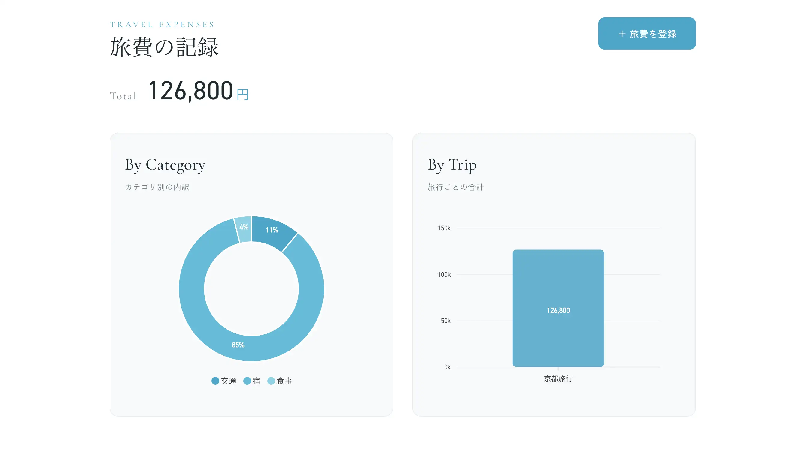

# ①課題名

旅費の記録

## ②課題内容（どんな作品か）

- 旅ごとの支出を登録し、合計とグラフで内訳を見渡せるアプリです。
- 「登録画面」では、旅行名・支出日・カテゴリ・金額・メモを入力して支出を1件ずつ記録します。
- 「一覧画面」では、登録した支出の一覧と総合計に加えて、カテゴリ別の内訳をドーナツグラフ、旅行ごとの合計を棒グラフで可視化しました。JSONファイルへの読み書きで動作する構成です。

## ③アプリのデプロイURL

- https://gs2026-arakawa.sakura.ne.jp//kadai06_basic_php/

## ④アプリのログイン用IDまたはPassword（ある場合）

- ログインなし（登録フォームから入力して登録するだけで利用できます）

## ⑤工夫した点・こだわった点

- まずはPHPの「登録」と「表示」が自分の手で実現できることを目標に進めました。授業で教えていただいた`file_put_contents()` / `file_get_contents()` でJSONを読み書きし、データを登録・参照しています。
- PHPで集計したデータを `json_encode()` でJavaScriptに渡し、ApexChartsというグラフライブラリに受け渡しています。カテゴリ別・旅行別の集計はPHP側で配列に足し込み、その結果をドーナツ／棒グラフに反映しています。
- ユーザー入力をHTMLに出す箇所はすべて `htmlspecialchars()`（func.phpで設定した共通関数 `h()`）を通して、XSS対策を施しました。
- 旅行名の入力欄は `<datalist>` を動的生成し、過去に登録した旅行名を候補として表示。同じ旅行に複数の支出を追加するときの手間を減らしています。

## ⑥難しかった点・次回トライしたいこと（又は機能）

- ApexChartsのグラフ表示に手こずりました。
- 次回は、登録したデータの更新・削除を加えてCRUD（Create／Read／Update／Delete）を完成させたいです。また、現在のファイルベース保存からデータベースに移行し、旅行ごとのデータの集計などをも見れるようにしたいです。

## ⑦フリー項目（感想、シェアしたいこと等なんでも）

今後、作りたいと思っている旅アプリに含まれる便利機能として作成しました。 
まずはファイルへの読み書きでCR（Create／Read）の仕組みそのものを理解するように努めました。
